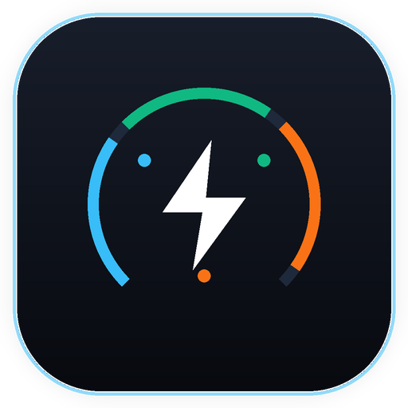
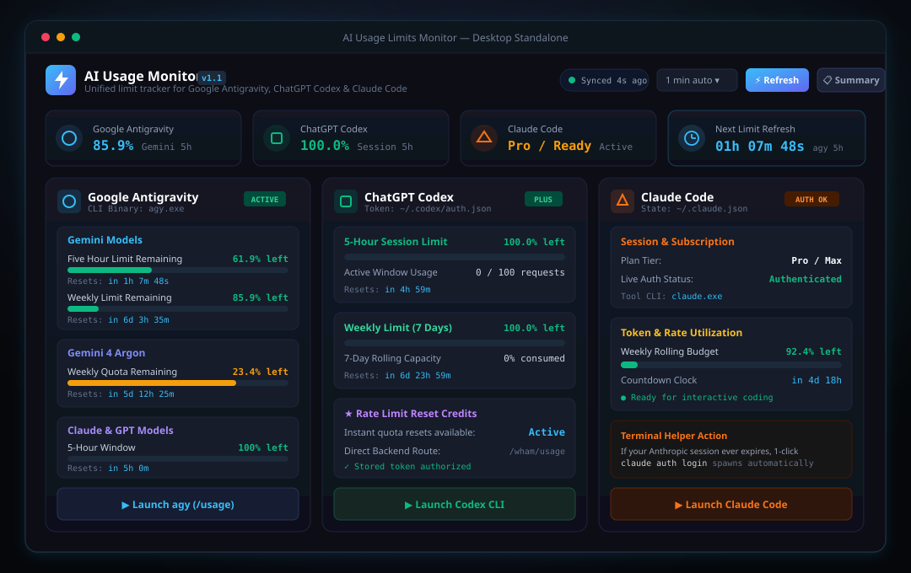
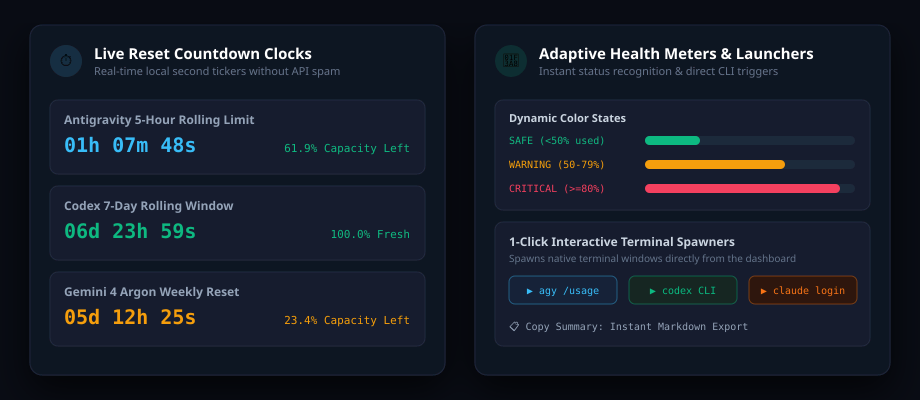
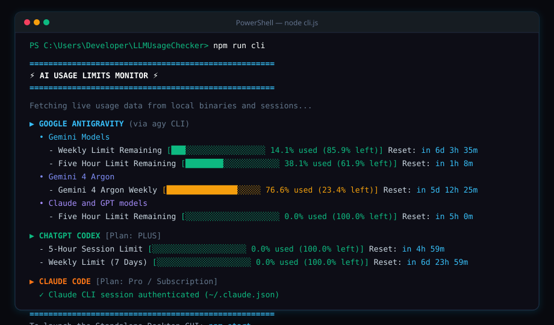

<div align="center">



# AI Usage Limits Monitor

**A unified, real-time desktop dashboard and terminal CLI for tracking AI quotas &amp; reset countdowns**

*Live session tracking, rolling 5-hour windows, weekly capacity, and live reset clocks across Google Antigravity, ChatGPT Codex, and Claude Code.*

<p>
  <a href="LICENSE"></a>
  
  
  
  
  
</p>

---

<p>
  <a href="#-about-ai-usage-monitor">About</a> •
  <a href="#-key-features">Features</a> •
  <a href="#-visual-tour">Visual Tour</a> •
  <a href="#-supported-providers">Supported Providers</a> •
  <a href="#-quick-start">Quick Start</a> •
  <a href="#-architecture--how-it-works">Architecture</a> •
  <a href="#-icon--design-philosophy">Design</a> •
  <a href="#-license--credits">License</a>
</p>

<picture>
  
</picture>

</div>

---

<a id="-about-ai-usage-monitor"></a>
## ⚡ About AI Usage Monitor

Modern software engineering increasingly relies on multiple frontier AI assistants simultaneously. You might draft high-level multi-file architecture with **Google Antigravity**, generate complex algorithms with **ChatGPT Codex**, and carry out rapid terminal refactoring sessions with **Claude Code**.

However, each provider enforces independent rate-limiting policies, rolling session windows, and weekly capacity quotas:
- **Google Antigravity** operates on strict 5-hour rolling limits alongside weekly model allotments (Gemini models, Claude & GPT 3rd-party models).
- **ChatGPT Codex** enforces both a 5-hour rolling session cap and a 7-day rolling window, supplemented by rate limit reset credits.
- **Claude Code** manages token utilization tiers and requires active CLI authentication.

Running into a sudden quota wall midway through an active debugging sprint breaks your concentration. Checking your remaining allowance traditionally required jumping across multiple web settings pages, deciphering disparate terminal outputs, or guessing when your limits refresh.

**AI Usage Limits Monitor unifies all three into one real-time cockpit:**

- 🎛️ **Centralized Quota Cockpit**: View Antigravity, Codex, and Claude Code status, usage percentages, and remaining allowances in one glance.
- ⏱️ **Live Reset Countdown Tickers**: Client-side countdown clocks tick down every second to display the exact moment your next capacity window unlocks.
- 🔑 **Zero-Config Local Re-use**: Automatically reads your active local CLI sessions (`agy.exe`, `~/.codex/auth.json`, and `~/.claude.json`). No API tokens or passwords to configure.
- 🖥️ **Native Standalone Feel**: Launches in Microsoft Edge / Google Chrome Application Mode (`--app`), looking and behaving like a native Windows utility without browser toolbars or tabs.
- 📟 **Instant Terminal CLI Companion**: Prefer staying in your terminal? Execute `npm run cli` for a fast, colorful ANSI report with ASCII capacity bars.
- 🛡️ **100% Local-First & Private**: Zero external telemetry, zero tracking pings, and zero analytics. All metric queries remain strictly between your machine and your authenticated provider endpoints.

---

<a id="-key-features"></a>
## 🌟 Key Features

<table>
  <tr>
    <td width="50%">
      <h3>⚡ Unified Multi-Provider Dashboard</h3>
      <p>Side-by-side capacity tracking for <b>Google Antigravity</b>, <b>ChatGPT Codex</b>, and <b>Claude Code</b> with real-time connection status badges (<code>ACTIVE</code>, <code>PLUS</code>, <code>AUTH OK</code>).</p>
    </td>
    <td width="50%">
      <h3>⏱️ Live Reset Countdown Clocks</h3>
      <p>Precise, active countdown timers calculating remaining time down to the second (<code>01h 07m 48s</code>). See when your rolling 5-hour or 7-day limits reset without hammering APIs.</p>
    </td>
  </tr>
  <tr>
    <td width="50%">
      <h3>🎨 Adaptive Health &amp; Capacity Meters</h3>
      <p>Color-coded progress gauges immediately signal quota health: <span style="color:#10b981"><b>Safe (&lt;50%)</b></span>, <span style="color:#f59e0b"><b>Warning (50–79%)</b></span>, and <span style="color:#f43f5e"><b>Critical (&ge;80%)</b></span>.</p>
    </td>
    <td width="50%">
      <h3>🖥️ Standalone Desktop App Mode</h3>
      <p>Launches via Edge/Chrome <code>--app</code> flag in custom 1200&times;860 dimensions. Enjoy a distraction-free, frameless desktop experience with an ambient dark glass aesthetic.</p>
    </td>
  </tr>
  <tr>
    <td width="50%">
      <h3>🚀 1-Click Interactive Terminal Spawners</h3>
      <p>Direct action buttons let you launch interactive terminal sessions for <code>agy (/usage)</code>, <code>codex</code>, or <code>claude auth login</code> with a single click.</p>
    </td>
    <td width="50%">
      <h3>📋 1-Click Markdown Summary Export</h3>
      <p>Quickly copy a formatted Markdown usage summary to your clipboard to paste into daily dev logs, share with teammates, or save for billing records.</p>
    </td>
  </tr>
</table>

---

<a id="-visual-tour"></a>
## 📸 Visual Tour

### 1. Standalone Desktop Interface
A dark-mode dashboard tailored for Windows 10 &amp; 11 with ambient backlighting, four quick overview stat cards, and deep provider breakdowns.

<p align="center">
  
</p>

### 2. Live Countdown Engine &amp; Dynamic Meters
Ticking countdown clocks display precise time remaining until quota replenishment, paired with visual threshold meters and direct terminal action buttons.

<p align="center">
  
</p>

### 3. Fast Terminal CLI Companion
When coding inside VS Code, Windows Terminal, or Neovim, run `npm run cli` to get an instantaneous, colorized status report without leaving your shell.

<p align="center">
  
</p>

---

<a id="-supported-providers"></a>
## 🤖 Supported Providers

| Provider | Data Source | Monitored Quota Windows | Reset Precision | Quick Action Launcher |
| :--- | :--- | :--- | :--- | :--- |
| **Google Antigravity** | `agy.exe -p "/usage"` | • Gemini 5-Hour Limit<br>• Gemini Weekly Allotment<br>• Claude &amp; GPT 5-Hour Window<br>• Gemini 4 Argon Weekly | Real-time seconds | `agy (/usage)` interactive terminal |
| **ChatGPT Codex** | `~/.codex/auth.json`<br>`/backend-api/wham/usage` | • 5-Hour Rolling Session Cap<br>• 7-Day Rolling Capacity<br>• Rate Limit Reset Credits | Real-time seconds | `codex` CLI terminal |
| **Claude Code** | `~/.claude.json`<br>`claude auth status` | • Weekly Rolling Token Utilization<br>• Subscription / Pro Tier<br>• Authentication Validation | Real-time seconds | `claude` CLI / `claude auth login` |

---

<a id="-quick-start"></a>
## 🚀 Quick Start

### Prerequisites

- **Windows 10 or 11** (x64)
- **Node.js 18+** installed on your system
- At least one installed AI developer tool (`agy`, `codex`, or `claude`)

### 1. Launch the Desktop App (GUI)

Simply double-click **`run-app.bat`** in the project folder, or run:

```bash
npm start
```

This starts the background HTTP server on port `3883` and immediately opens the standalone Edge/Chrome application window.

### 2. Run the Terminal CLI Mode

To inspect your quotas directly inside PowerShell, Windows Terminal, or CMD:

```bash
npm run cli
# or
node cli.js
```

### 3. Run Headless Server Only

If you prefer viewing the dashboard inside your regular browser (or streaming usage metrics to another local device):

```bash
npm run server
```

Then navigate to `http://localhost:3883` in any browser.

---

<a id="-architecture--how-it-works"></a>
## ⚙️ Architecture &amp; How It Works

```
                        ┌───────────────────────────────────────────┐
                        │      Standalone Desktop UI / CLI          │
                        │ (Edge App Mode / Terminal node cli.js)    │
                        └─────────────────────┬─────────────────────┘
                                              │ HTTP / JSON
                                              ▼
                        ┌───────────────────────────────────────────┐
                        │        Local Node.js Microserver          │
                        │    (15s Cache & Request Deduplication)     │
                        └───┬─────────────────┬─────────────────┬───┘
                            │                 │                 │
              agy.exe Query │                 │ Auth Token      │ claude auth
                            ▼                 ▼                 ▼
             ┌─────────────────────┐ ┌─────────────────┐ ┌─────────────────┐
             │  Google Antigravity │ │  ChatGPT Codex  │ │   Claude Code   │
             │   /usage command    │ │   /wham/usage   │ │   ~/.claude.json│
             └─────────────────────┘ └─────────────────┘ └─────────────────┘
```

### Provider Integration Details

1. **Google Antigravity (`services/antigravity.js`)**:
   - Executes `agy.exe -p "/usage" --output-format json` under the hood.
   - Extracts structured buckets for Gemini models, 3rd-party models (Claude/GPT), and experimental tiers like Gemini 4 Argon.
   - Parses ISO timestamp reset targets and computes live second offsets.

2. **ChatGPT Codex (`services/codex.js`)**:
   - Reads existing local authentication tokens from `%USERPROFILE%\.codex\auth.json`.
   - Queries OpenAI's internal usage endpoint (`https://chatgpt.com/backend-api/wham/usage`) using your session credentials.
   - Retrieves exact 5-hour rolling utilization percentages, 7-day weekly limits, model reserves (such as `gpt-5.6-luna`), and instant rate-limit reset credits.

3. **Claude Code (`services/claude.js`)**:
   - Inspects `claude auth status` to verify CLI sign-in validity.
   - Parses `%USERPROFILE%\.claude.json` for cached token metrics and plan identifiers.
   - Provides an automated 1-click terminal launcher to run `claude auth login` whenever sessions need a refresh.

### Rate-Limiting Protection &amp; Caching

To guarantee that the monitor itself never exhausts your quotas:
- **15-Second In-Memory Cache**: Repeated dashboard refreshes or auto-polls serve cached metrics within 15 seconds of the last poll.
- **Flight Deduplication**: Concurrent requests share a single in-flight Promise so external binaries and APIs are never called redundantly.

---

<a id="-icon--design-philosophy"></a>
## 🎨 Icon &amp; Design Philosophy

<p align="center">
  
</p>

> *"An obsidian dark squircle radiating with electric telemetry energy, encircled by three harmonic provider nodes and a tripartite quota arc."*

- **Obsidian Dark Ceramic**: Echoes the dark developer workspaces favored by command-line and IDE power users.
- **Tri-Color Provider Orbits**:
  - <span style="color:#38bdf8">**Antigravity Cyan (`#38bdf8`)**</span>: Represents Google Antigravity and the Gemini family.
  - <span style="color:#10b981">**Codex Emerald (`#10b981`)**</span>: Represents OpenAI ChatGPT Codex.
  - <span style="color:#f97316">**Claude Orange (`#f97316`)**</span>: Represents Anthropic Claude Code.
- **Electric Energy Bolt**: Symbolizes high-frequency telemetry, live status updates, and instantaneous quota awareness.

---

<a id="-license--credits"></a>
## 📄 License &amp; Credits

This project is licensed under the **[MIT License](LICENSE)**.

- **Attribution**: Google Antigravity, ChatGPT / OpenAI, and Claude / Anthropic are trademarks of their respective owners. AI Usage Limits Monitor is an independent open-source tool and is not affiliated with or endorsed by Google, OpenAI, or Anthropic.
- **Feedback &amp; Contributions**: Pull requests and suggestions are welcome.
